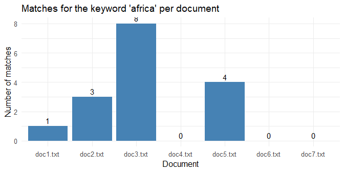

Question 1 - Keyword search with Hadoop Streaming MapReduce (R)
================

- [1. Problem and design (question
  1.1)](#1-problem-and-design-question-11)
- [2. Input data](#2-input-data)
- [3. Mapper (question 1.2)](#3-mapper-question-12)
- [4. Reducer (question 1.3)](#4-reducer-question-13)
- [5. Running the job](#5-running-the-job)
  - [Mapper output (filename, row,
    column)](#mapper-output-filename-row-column)
  - [Reducer output (final result)](#reducer-output-final-result)
- [6. Validation against an independent
  check](#6-validation-against-an-independent-check)
- [7. The keyword is dynamic](#7-the-keyword-is-dynamic)
- [8. Hadoop configuration (question
  1.4)](#8-hadoop-configuration-question-14)
- [9. Summary](#9-summary)

## 1. Problem and design (question 1.1)

**Task.** Search a corpus of news articles for a keyword
(case-insensitive) and return the **row (line number)** and **column
(character position)** of every match in every document. The keyword is
a runtime input, never hardcoded.

**MapReduce design** (R scripts run through Hadoop Streaming):

     documents + keyword
            |
       [ Mapper 1 ]  [ Mapper 2 ] ... [ Mapper 7 ]    one mapper per document (input split)
            |  emit:  filename <TAB> row <TAB> column
            v
       Shuffle and sort  (group records by filename)
            |
       [ Reducer ]        count and sort the (row, column) pairs per file
            |
       part-00000:  filename <TAB> total <TAB> (row,col) (row,col) ...

Matching rules: whole word, case-insensitive, row and column start at 1,
blank lines count as rows, and every occurrence on a line is reported.

## 2. Input data

``` r
files <- sort(list.files(input_dir, pattern = "\\.txt$", full.names = TRUE, recursive = TRUE))
files <- files[!grepl("__MACOSX", files)]
corpus <- data.frame(
  document = basename(files),
  lines    = vapply(files, function(f) length(readLines(f, warn = FALSE)), integer(1)),
  words    = vapply(files, function(f) length(scan(f, what = "", quiet = TRUE, encoding = "UTF-8")), integer(1)),
  row.names = NULL
)
knitr::kable(corpus, caption = "Documents in the corpus")
```

| document | lines | words |
|:---------|------:|------:|
| doc1.txt |    55 |   644 |
| doc2.txt |    64 |   682 |
| doc3.txt |    56 |   651 |
| doc4.txt |    24 |   249 |
| doc5.txt |    48 |   588 |
| doc6.txt |    21 |   280 |
| doc7.txt |    39 |   399 |

Documents in the corpus

## 3. Mapper (question 1.2)

`mapper.R` reads one document from standard input and emits one record
per match. The keyword is passed as a command-line argument.

    #!/usr/bin/env Rscript
    # mapper.R - Hadoop Streaming mapper (keyword search with row/column)
    # Usage : Rscript mapper.R <keyword>
    # Input : text lines on stdin (one input split = one document)
    # Output: filename <TAB> row <TAB> column      (one record per match)

    args <- commandArgs(trailingOnly = TRUE)
    if (length(args) < 1 || !nzchar(args[1])) {
      write("ERROR: keyword argument missing. Usage: Rscript mapper.R <keyword>", stderr())
      quit(status = 1)
    }
    keyword <- args[1]

    # Escape regex metacharacters so the keyword is matched literally,
    # then add word boundaries so "africa" does not match "African".
    escape_regex <- function(x) gsub("([][{}()+*^$|\\\\?.])", "\\\\\\1", x)
    pattern <- paste0("\\b", escape_regex(keyword), "\\b")

    # Hadoop exposes the current input file as an environment variable
    input_file <- Sys.getenv("mapreduce_map_input_file",
                             unset = Sys.getenv("map_input_file", unset = "unknown"))
    doc_name <- basename(input_file)

    con <- file("stdin", open = "r")
    row <- 0L

    repeat {
      lines <- readLines(con, n = 1000L, warn = FALSE)
      if (length(lines) == 0L) break
      Encoding(lines) <- "UTF-8"   # mark (do not re-encode) so columns count characters, not bytes
      
      for (line in lines) {
        row <- row + 1L            # blank lines still count as rows
        if (!nzchar(line)) next
        
        # case-insensitive search; (?i) works with perl = TRUE
        m <- gregexpr(paste0("(?i)", pattern), line, perl = TRUE)[[1]]
        if (m[1] != -1L) {
          for (col in as.integer(m)) {   # one record per occurrence
            cat(doc_name, "\t", row, "\t", col, "\n", sep = "")
          }
        }
      }
    }
    close(con)

## 4. Reducer (question 1.3)

`reducer.R` receives the sorted records and writes one summary line per
document.

    #!/usr/bin/env Rscript
    # reducer.R - Hadoop Streaming reducer
    # Input : filename <TAB> row <TAB> column   (sorted by filename by the shuffle)
    # Output: filename <TAB> total matches <TAB> (row,col) (row,col) ...

    con <- file("stdin", open = "r")

    current <- NULL
    rows <- integer(0); cols <- integer(0)

    emit <- function(key, rows, cols) {
      if (is.null(key)) return(invisible())
      o <- order(rows, cols)                        # numeric order: row, then column
      locs <- paste0("(", rows[o], ",", cols[o], ")", collapse = " ")
      cat(key, "\t", length(rows), "\t", locs, "\n", sep = "")
    }

    repeat {
      lines <- readLines(con, n = 1000L, warn = FALSE)
      if (length(lines) == 0L) break
      for (line in lines) {
        f <- strsplit(line, "\t", fixed = TRUE)[[1]]
        if (length(f) < 3L) next                    # skip malformed records
        key <- f[1]
        if (is.null(current) || key != current) {   # new key -> flush previous group
          emit(current, rows, cols)
          current <- key
          rows <- integer(0); cols <- integer(0)
        }
        rows <- c(rows, as.integer(f[2]))
        cols <- c(cols, as.integer(f[3]))
      }
    }
    emit(current, rows, cols)                       # flush the last group
    close(con)

## 5. Running the job

Hadoop is not installed on the development machine, so the pipeline is
simulated locally with exactly the same scripts: one mapper process per
document, the same `mapreduce_map_input_file` variable that Hadoop sets,
a sort by key, then the reducer.

``` r
run_pipeline <- function(keyword) {
  map_out <- character(0)
  for (f in files) {
    Sys.setenv(mapreduce_map_input_file = f)               # what Hadoop sets for each split
    out <- system2(rscript, c("mapper.R", shQuote(keyword)), stdin = f, stdout = TRUE)
    map_out <- c(map_out, out)
  }
  if (length(map_out) == 0) return(list(map = map_out, shuffled = map_out, reduced = map_out))
  key      <- sub("\t.*", "", map_out)
  shuffled <- map_out[order(key, method = "radix")]        # shuffle and sort: group by filename
  tmp      <- tempfile(); writeLines(shuffled, tmp)
  list(map = map_out, shuffled = shuffled,
       reduced = system2(rscript, "reducer.R", stdin = tmp, stdout = TRUE))
}

res <- run_pipeline(params$keyword)
```

### Mapper output (filename, row, column)

``` r
map_df <- read.table(text = res$map, sep = "\t", col.names = c("document", "row", "column"), stringsAsFactors = FALSE)
knitr::kable(map_df, caption = paste0("Records emitted by the mappers for the keyword '", params$keyword, "'"))
```

| document | row | column |
|:---------|----:|-------:|
| doc1.txt |   1 |     64 |
| doc2.txt |   1 |     57 |
| doc2.txt |  33 |     24 |
| doc2.txt |  58 |     81 |
| doc3.txt |   1 |     38 |
| doc3.txt |   3 |      7 |
| doc3.txt |   5 |      7 |
| doc3.txt |  40 |    146 |
| doc3.txt |  46 |      7 |
| doc3.txt |  50 |    142 |
| doc3.txt |  52 |     86 |
| doc3.txt |  54 |     44 |
| doc5.txt |   1 |     62 |
| doc5.txt |   3 |     88 |
| doc5.txt |  23 |    121 |
| doc5.txt |  38 |     27 |

Records emitted by the mappers for the keyword ‘africa’

### Reducer output (final result)

``` r
red_df <- read.table(text = res$reduced, sep = "\t", quote = "", col.names = c("document", "matches", "positions (row,col)"),
                     stringsAsFactors = FALSE, check.names = FALSE)
knitr::kable(red_df, caption = "Final result: matches and positions per document")
```

| document | matches | positions (row,col) |
|:---|---:|:---|
| doc1.txt | 1 | (1,64) |
| doc2.txt | 3 | (1,57) (33,24) (58,81) |
| doc3.txt | 8 | (1,38) (3,7) (5,7) (40,146) (46,7) (50,142) (52,86) (54,44) |
| doc5.txt | 4 | (1,62) (3,88) (23,121) (38,27) |

Final result: matches and positions per document

``` r
counts <- merge(corpus["document"], red_df[, c("document", "matches")], all.x = TRUE)
counts$matches[is.na(counts$matches)] <- 0
ggplot(counts, aes(x = document, y = matches)) +
  geom_col(fill = "steelblue") +
  geom_text(aes(label = matches), vjust = -0.4) +
  labs(title = paste0("Matches for the keyword '", params$keyword, "' per document"),
       x = "Document", y = "Number of matches") +
  theme_minimal(base_size = 12)
```

<!-- -->

## 6. Validation against an independent check

The result is compared with a direct regular-expression search over the
same files, written separately from the mapper.

``` r
direct <- do.call(rbind, lapply(files, function(f) {
  txt <- readLines(f, warn = FALSE, encoding = "UTF-8"); Encoding(txt) <- "UTF-8"
  hits <- lapply(seq_along(txt), function(i) {
    m <- gregexpr(paste0("(?i)\\b", params$keyword, "\\b"), txt[i], perl = TRUE)[[1]]
    if (m[1] == -1) NULL else data.frame(document = basename(f), row = i, column = as.integer(m))
  })
  do.call(rbind, hits)
}))
cat("Total matches - MapReduce:", nrow(map_df), "| direct search:", nrow(direct), "\n")
```

    #> Total matches - MapReduce: 16 | direct search: 16

``` r
a <- map_df[order(map_df$document, map_df$row, map_df$column), ]
b <- direct[order(direct$document, direct$row, direct$column), ]
cat("Identical row/column positions:", isTRUE(all.equal(a, b, check.attributes = FALSE)), "\n")
```

    #> Identical row/column positions: TRUE

## 7. The keyword is dynamic

The same code is re-run with a second keyword.

``` r
res2 <- run_pipeline("visa")
knitr::kable(read.table(text = res2$reduced, sep = "\t", quote = "", col.names = c("document", "matches", "positions (row,col)"), check.names = FALSE),
             caption = "Result for the keyword 'visa'")
```

| document | matches | positions (row,col) |
|:---|---:|:---|
| doc3.txt | 12 | (3,16) (7,40) (9,187) (13,69) (42,53) (43,88) (44,12) (46,92) (46,114) (48,18) (50,29) (52,13) |
| doc5.txt | 2 | (19,127) (48,77) |

Result for the keyword ‘visa’

To use another keyword, knit this notebook with
`rmarkdown::render("Q1_MapReduce_Notebook.Rmd", params = list(keyword = "eskom"))`.

## 8. Hadoop configuration (question 1.4)

On a Hadoop cluster the same scripts are submitted with `run_job.sh`:

    #!/bin/bash
    # run_job.sh - Submit the keyword search as a Hadoop Streaming job
    # Usage: ./run_job.sh <keyword>

    KEYWORD="$1"
    INPUT=/user/mikay/map_reduce_test_docs
    OUTPUT=/user/mikay/keyword_output

    hdfs dfs -rm -r -f $OUTPUT

    hadoop jar $HADOOP_HOME/share/hadoop/tools/lib/hadoop-streaming-*.jar \
    -D mapreduce.job.name="Keyword search - $KEYWORD" \
    -D mapreduce.job.reduces=1 \
    -D mapreduce.input.fileinputformat.split.minsize=1073741824 \
    -D stream.num.map.output.key.fields=1 \
    -files mapper.R,reducer.R \
    -mapper "Rscript mapper.R $KEYWORD" \
    -reducer "Rscript reducer.R" \
    -input $INPUT \
    -output $OUTPUT

| Setting | Purpose |
|----|----|
| `mapreduce.job.reduces=1` | One reducer, so one sorted output file `part-00000` |
| `mapreduce.input.fileinputformat.split.minsize=1073741824` | Never split a file across mappers, so row numbers stay correct |
| `stream.num.map.output.key.fields=1` | The filename is the key; row and column are the value |
| `-files mapper.R,reducer.R` | Ship the scripts to every node |
| `-mapper "Rscript mapper.R $KEYWORD"` | Pass the keyword at run time (dynamic input) |

## 9. Summary

The mapper turns every keyword occurrence into a `(file, row, column)`
record, the shuffle groups the records by file, and the reducer produces
a sorted list of positions per document. The result agrees with an
independent search, and the keyword is a run-time parameter.
