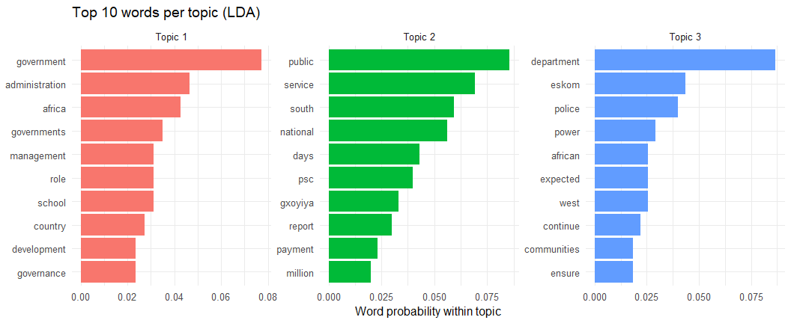
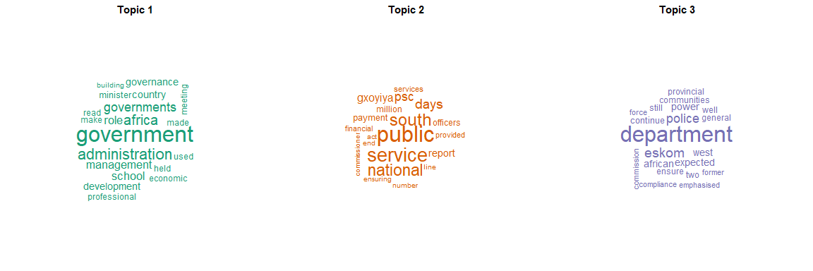
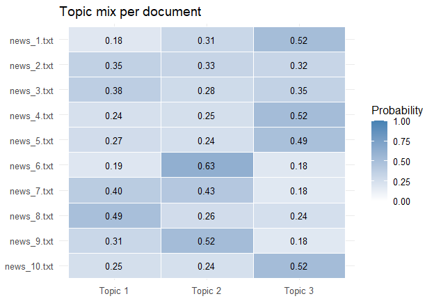

Question 2 - Topic modelling of news articles with LDA
================

- [2.1 Data frame and pre-processing](#21-data-frame-and-pre-processing)
  - [Load the files into a data frame (col_1 = file_name, col_2 =
    content)](#load-the-files-into-a-data-frame-col_1--file_name-col_2--content)
  - [Denoise the text](#denoise-the-text)
- [2.2 Latent Dirichlet Allocation](#22-latent-dirichlet-allocation)
  - [Top words per topic and their
    probabilities](#top-words-per-topic-and-their-probabilities)
  - [Topic mix per document](#topic-mix-per-document)
- [2.3 Visualisation](#23-visualisation)
  - [Method 1 - bar charts of the top
    words](#method-1---bar-charts-of-the-top-words)
  - [Method 2 - word clouds](#method-2---word-clouds)
  - [Method 3 - heatmap of the topic mix per
    document](#method-3---heatmap-of-the-topic-mix-per-document)
- [Interpretation](#interpretation)

**Goal.** Build a data frame of news files, denoise the text, fit a
Latent Dirichlet Allocation (LDA) model, report the top 10 words for
each of 3 topics (with their probabilities) and visualise the result.

## 2.1 Data frame and pre-processing

### Load the files into a data frame (col_1 = file_name, col_2 = content)

``` r
files <- list.files(input_dir, pattern = "\\.txt$", full.names = TRUE, recursive = TRUE)
files <- files[!grepl("__MACOSX", files) & !grepl("^\\._", basename(files))]
files <- files[order(as.numeric(gsub("\\D", "", basename(files))))]

read_doc <- function(f) {
  txt <- readLines(f, warn = FALSE, encoding = "UTF-8"); Encoding(txt) <- "UTF-8"
  paste(txt, collapse = " ")
}
news_df <- data.frame(file_name = basename(files),
                      content   = vapply(files, read_doc, character(1), USE.NAMES = FALSE),
                      stringsAsFactors = FALSE)
headlines <- vapply(files, function(f) trimws(readLines(f, n = 1, warn = FALSE, encoding = "UTF-8")),
                    character(1), USE.NAMES = FALSE)

knitr::kable(data.frame(file_name = news_df$file_name,
                        content = paste0(substr(news_df$content, 1, 70), "..."),
                        words = vapply(strsplit(news_df$content, "\\s+"), length, integer(1))),
             caption = "Raw data frame (first 70 characters of each article)")
```

| file_name | content | words |
|:---|:---|---:|
| news_1.txt | Eskom former official, service provider appear in court Tuesday, July … | 237 |
| news_2.txt | Gauteng Education commits to implementing Mayibuye Primary School reme… | 285 |
| news_3.txt | New Labour Minister charts the way forward Tuesday, July 9, 2024 New… | 633 |
| news_4.txt | Police recue two kidnapped victims in Benoni Tuesday, July 9, 2024 Sw… | 215 |
| news_5.txt | President Ramaphosa sends condolences to deceased SANDF members Tuesda… | 257 |
| news_6.txt | Accounting officers must be accountable for non-payment of service pro… | 450 |
| news_7.txt | Democratic dispensation necessitated a complete overhaul of state bure… | 241 |
| news_8.txt | Trust and relationships key ingredients to coalition governments Monda… | 720 |
| news_9.txt | PSC applauds officials who refuse to accept a bribes Monday, July 8, 2… | 349 |
| news_10.txt | Wet, cold weather expected to continue in Western Cape Monday, July 8,… | 445 |

Raw data frame (first 70 characters of each article)

### Denoise the text

Steps: remove date lines and site names, curly quotes, possessives,
punctuation and numbers; convert to lower case; remove stop words
(English list plus corpus-specific words) and words shorter than three
letters.

``` r
custom_stop <- c("said", "says", "say", "will", "also", "can", "may", "must", "would",
                 "could", "should", "one", "per", "cent", "added", "according",
                 "however", "including", "among", "since", "new", "year", "years",
                 "sanews", "gov", "monday", "tuesday", "wednesday", "thursday", "friday",
                 "saturday", "sunday", "january", "february", "march", "april", "june",
                 "july", "august", "september", "october", "november", "december")
stop_all <- unique(c(tm::stopwords("english"), custom_stop))
weekdays_rx <- "(monday|tuesday|wednesday|thursday|friday|saturday|sunday)"
months_rx   <- "(january|february|march|april|may|june|july|august|september|october|november|december)"

clean_text <- function(x) {
  x <- gsub("[\r\n\t]", " ", x)
  x <- gsub("[\u2018\u2019\u201B\u00B4`]", "'", x, perl = TRUE)
  x <- gsub("[\u201C\u201D]", " ", x, perl = TRUE)
  x <- tolower(x)
  x <- gsub(paste0(weekdays_rx, ",? +", months_rx, " +[0-9]{1,2},? +[0-9]{4}"), " ", x)
  x <- gsub("https?://[^ ]+|www\\.[^ ]+|[a-z0-9.]+\\.(gov|co|org|com)\\.za", " ", x)
  x <- gsub("[^ ]+@[^ ]+", " ", x)
  x <- gsub("'s\\b", "", x, perl = TRUE)
  x <- gsub("[^a-z ]", " ", x)
  words <- strsplit(x, " +")[[1]]
  words <- words[nchar(words) >= 3 & !(words %in% stop_all)]
  paste(words, collapse = " ")
}
news_df$clean_content <- vapply(news_df$content, clean_text, character(1), USE.NAMES = FALSE)

summary_df <- data.frame(file_name = news_df$file_name,
                         words_before = vapply(strsplit(news_df$content, "\\s+"), length, integer(1)),
                         words_after  = vapply(strsplit(news_df$clean_content, " "), length, integer(1)))
knitr::kable(summary_df, caption = "Word counts before and after pre-processing")
```

| file_name   | words_before | words_after |
|:------------|-------------:|------------:|
| news_1.txt  |          237 |         127 |
| news_2.txt  |          285 |         156 |
| news_3.txt  |          633 |         342 |
| news_4.txt  |          215 |         119 |
| news_5.txt  |          257 |         137 |
| news_6.txt  |          450 |         227 |
| news_7.txt  |          241 |         141 |
| news_8.txt  |          720 |         408 |
| news_9.txt  |          349 |         195 |
| news_10.txt |          445 |         249 |

Word counts before and after pre-processing

``` r
cat("BEFORE:", substr(news_df$content[1], 1, 220), "...\n\n")
```

    #> BEFORE: Eskom former official, service provider appear in court Tuesday, July 9, 2024  An Eskom former employee and a service provider at the power utility have appeared in the Hendrina Magistrates’ Court to face charges of thef ...

``` r
cat("AFTER :", substr(news_df$clean_content[1], 1, 220), "...\n")
```

    #> AFTER : eskom former official service provider appear court eskom former employee service provider power utility appeared hendrina magistrates court face charges theft fraud two made separate appearances court released bail powe ...

## 2.2 Latent Dirichlet Allocation

A document-term matrix is built (keeping terms that appear in at least
two documents) and an LDA model with Gibbs sampling is fitted with a
fixed seed so the result is reproducible.

``` r
corpus <- VCorpus(VectorSource(news_df$clean_content))
dtm    <- DocumentTermMatrix(corpus, control = list(wordLengths = c(3, Inf)))
dtm    <- dtm[, slam::col_sums(dtm > 0) >= 2]
keep   <- slam::row_sums(dtm) > 0
dtm    <- dtm[keep, ]
doc_names <- news_df$file_name[keep]
cat("Document-term matrix:", nrow(dtm), "documents x", ncol(dtm), "terms\n")
```

    #> Document-term matrix: 10 documents x 187 terms

``` r
lda_model <- LDA(dtm, k = n_topics, method = "Gibbs",
                 control = list(seed = seed, burnin = 1000, iter = 2000, thin = 100))
post  <- posterior(lda_model)
beta  <- post$terms      # topic x term: word distribution of each topic
gamma <- post$topics     # document x topic: topic mixture of each document
```

### Top words per topic and their probabilities

``` r
top_terms <- do.call(rbind, lapply(seq_len(n_topics), function(t) {
  ord <- order(beta[t, ], decreasing = TRUE)[seq_len(k_words)]
  data.frame(topic = paste("Topic", t), rank = seq_len(k_words),
             term = colnames(beta)[ord], probability = round(beta[t, ord], 4))
}))
for (t in seq_len(n_topics)) {
  sub <- top_terms[top_terms$topic == paste("Topic", t), ]
  cat("Topic ", t, ": ", paste(sub$term, collapse = ", "), "\n", sep = "")
}
```

    #> Topic 1: government, administration, africa, governments, management, role, school, country, development, governance
    #> Topic 2: public, service, south, national, days, psc, gxoyiya, report, payment, million
    #> Topic 3: department, eskom, police, power, african, expected, west, continue, communities, ensure

``` r
knitr::kable(top_terms, row.names = FALSE, caption = "Word distribution: probability of each top word within its topic")
```

| topic   | rank | term           | probability |
|:--------|-----:|:---------------|------------:|
| Topic 1 |    1 | government     |      0.0774 |
| Topic 1 |    2 | administration |      0.0466 |
| Topic 1 |    3 | africa         |      0.0427 |
| Topic 1 |    4 | governments    |      0.0350 |
| Topic 1 |    5 | management     |      0.0312 |
| Topic 1 |    6 | role           |      0.0312 |
| Topic 1 |    7 | school         |      0.0312 |
| Topic 1 |    8 | country        |      0.0273 |
| Topic 1 |    9 | development    |      0.0235 |
| Topic 1 |   10 | governance     |      0.0235 |
| Topic 2 |    1 | public         |      0.0857 |
| Topic 2 |    2 | service        |      0.0692 |
| Topic 2 |    3 | south          |      0.0594 |
| Topic 2 |    4 | national       |      0.0561 |
| Topic 2 |    5 | days           |      0.0430 |
| Topic 2 |    6 | psc            |      0.0397 |
| Topic 2 |    7 | gxoyiya        |      0.0331 |
| Topic 2 |    8 | report         |      0.0299 |
| Topic 2 |    9 | payment        |      0.0233 |
| Topic 2 |   10 | million        |      0.0200 |
| Topic 3 |    1 | department     |      0.0868 |
| Topic 3 |    2 | eskom          |      0.0436 |
| Topic 3 |    3 | police         |      0.0400 |
| Topic 3 |    4 | power          |      0.0292 |
| Topic 3 |    5 | african        |      0.0256 |
| Topic 3 |    6 | expected       |      0.0256 |
| Topic 3 |    7 | west           |      0.0256 |
| Topic 3 |    8 | continue       |      0.0220 |
| Topic 3 |    9 | communities    |      0.0184 |
| Topic 3 |   10 | ensure         |      0.0184 |

Word distribution: probability of each top word within its topic

### Topic mix per document

``` r
doc_topics <- data.frame(file_name = doc_names, round(gamma, 3), check.names = FALSE)
colnames(doc_topics)[2:(n_topics + 1)] <- paste("Topic", seq_len(n_topics))
doc_topics$dominant_topic <- paste("Topic", apply(gamma, 1, which.max))
doc_topics$headline <- headlines[keep]
knitr::kable(doc_topics, row.names = FALSE, caption = "Document-topic probabilities and dominant topic")
```

| file_name | Topic 1 | Topic 2 | Topic 3 | dominant_topic | headline |
|:---|---:|---:|---:|:---|:---|
| news_1.txt | 0.179 | 0.306 | 0.515 | Topic 3 | Eskom former official, service provider appear in court |
| news_2.txt | 0.354 | 0.328 | 0.319 | Topic 1 | Gauteng Education commits to implementing Mayibuye Primary School remedial actions |
| news_3.txt | 0.377 | 0.277 | 0.346 | Topic 1 | New Labour Minister charts the way forward |
| news_4.txt | 0.236 | 0.246 | 0.518 | Topic 3 | Police recue two kidnapped victims in Benoni |
| news_5.txt | 0.265 | 0.244 | 0.491 | Topic 3 | President Ramaphosa sends condolences to deceased SANDF members |
| news_6.txt | 0.191 | 0.625 | 0.184 | Topic 2 | Accounting officers must be accountable for non-payment of service providers |
| news_7.txt | 0.395 | 0.429 | 0.175 | Topic 2 | Democratic dispensation necessitated a complete overhaul of state bureaucracy |
| news_8.txt | 0.493 | 0.264 | 0.243 | Topic 1 | Trust and relationships key ingredients to coalition governments |
| news_9.txt | 0.309 | 0.516 | 0.175 | Topic 2 | PSC applauds officials who refuse to accept a bribes |
| news_10.txt | 0.245 | 0.238 | 0.517 | Topic 3 | Wet, cold weather expected to continue in Western Cape |

Document-topic probabilities and dominant topic

## 2.3 Visualisation

### Method 1 - bar charts of the top words

``` r
bar_df <- top_terms
bar_df$id <- factor(seq_len(nrow(bar_df)), levels = rev(seq_len(nrow(bar_df))))
ggplot(bar_df, aes(x = id, y = probability, fill = topic)) +
  geom_col(show.legend = FALSE) + coord_flip() + facet_wrap(~ topic, scales = "free") +
  scale_x_discrete(labels = setNames(bar_df$term, bar_df$id)) +
  labs(title = paste("Top", k_words, "words per topic (LDA)"), x = NULL, y = "Word probability within topic") +
  theme_minimal(base_size = 12)
```

<!-- -->

### Method 2 - word clouds

``` r
op <- par(mfrow = c(1, n_topics), mar = c(0, 0, 2, 0))
for (t in seq_len(n_topics)) {
  top <- sort(beta[t, ], decreasing = TRUE)[1:20]
  set.seed(seed)
  wordcloud(names(top), top, scale = c(3, 0.6), min.freq = 0, random.order = FALSE,
            colors = brewer.pal(8, "Dark2")[t])
  title(main = paste("Topic", t), cex.main = 1.4)
}
```

<!-- -->

``` r
par(op)
```

### Method 3 - heatmap of the topic mix per document

``` r
heat_df <- data.frame(file_name = rep(doc_names, times = n_topics),
                      topic = rep(paste("Topic", seq_len(n_topics)), each = length(doc_names)),
                      probability = as.vector(gamma))
heat_df$file_name <- factor(heat_df$file_name, levels = rev(doc_names))
ggplot(heat_df, aes(x = topic, y = file_name, fill = probability)) +
  geom_tile(colour = "white") + geom_text(aes(label = sprintf("%.2f", probability)), size = 3.5) +
  scale_fill_gradient(low = "white", high = "steelblue", limits = c(0, 1)) +
  labs(title = "Topic mix per document", x = NULL, y = NULL, fill = "Probability") + theme_minimal(base_size = 12)
```

<!-- -->

## Interpretation

With only ten short articles the topics are broad and overlap, so the
topic mix per document is fairly diffuse (most documents have a dominant
topic below 0.6). The three topics separate roughly into
public-administration and governance language, public-service and
commission reporting, and departmental, policing and power-utility news.
A larger corpus would give sharper topics.
